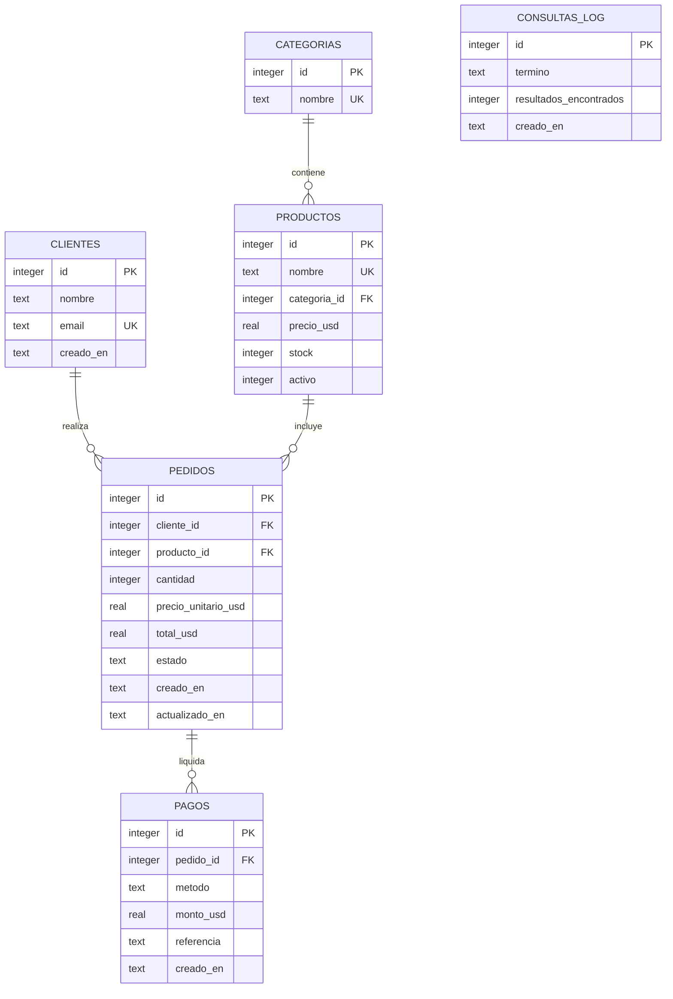
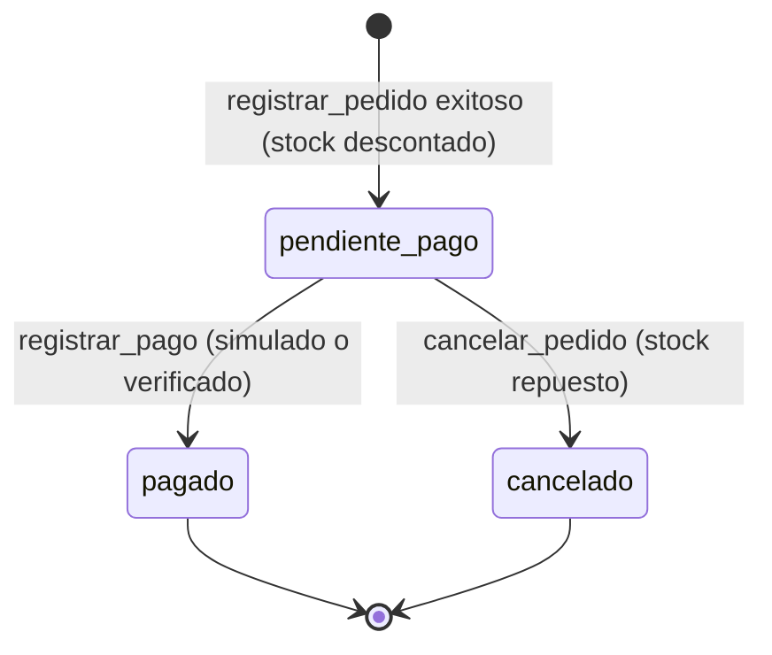

# Data Model: Capa de Datos de PixelOrbe

**Feature**: `specs/001-capa-datos-pixelorbe`
**Date**: 2026-11-16
**Status**: Completed

## Relational Schema (SQLite)

El esquema relacional implementado en `init_db.py` y consultado por `tools_db.py` está compuesto por 6 tablas principales con integridad referencial activa (`PRAGMA foreign_keys = ON`).

---

## Entidades y Reglas de Validación

### 1. `categorias`
Representa las familias de productos disponibles en el catálogo comercial.
- `id` (INTEGER, PK, AUTOINCREMENT): Identificador único de categoría.
- `nombre` (TEXT, NOT NULL, UNIQUE): Nombre de la categoría (ej. 'Laptops', 'Periféricos', 'Monitores').

### 2. `productos`
Artículos disponibles para consulta y venta.
- `id` (INTEGER, PK): Identificador numérico fijo.
- `nombre` (TEXT, NOT NULL, UNIQUE): Nombre comercial completo del producto.
- `categoria_id` (INTEGER, NOT NULL, FK -> `categorias(id)`): Categoría a la que pertenece.
- `precio_usd` (REAL, NOT NULL, CHECK `precio_usd > 0`): Precio unitario en dólares estadounidenses.
- `stock` (INTEGER, NOT NULL, CHECK `stock >= 0`): Unidades físicas disponibles en almacén.
- `activo` (INTEGER, NOT NULL, DEFAULT 1, CHECK `activo IN (0, 1)`): Estado de disponibilidad para venta.

**Reglas de negocio**:
- El catálogo contiene 48 productos distribuidos en 6 categorías.
- Exactamente 9 productos tienen `stock = 0` (condición de "agotado").
- Productos de prueba inmutables:
  - ID 9: `Laptop Lenovo IdeaPad 15`, precio: 580.0, stock: 12.
  - ID 26: `Monitor Samsung Odyssey G3 24 pulgadas`, precio: 210.0, stock: 0.
  - ID 40: `Mouse Logitech M185`, precio: 15.0, stock: 60.

### 3. `clientes`
Compradores registrados en la plataforma.
- `id` (INTEGER, PK, AUTOINCREMENT): Identificador único del cliente.
- `nombre` (TEXT, NOT NULL): Nombre del cliente.
- `email` (TEXT, NOT NULL, UNIQUE): Correo electrónico del cliente.
- `creado_en` (TEXT, DEFAULT CURRENT_TIMESTAMP): Fecha de registro en formato ISO.

**Validación**:
- Formato de correo validado con expresión regular: `^[^@\s]+@[^@\s]+\.[^@\s]+$`.

### 4. `pedidos`
Órdenes de compra generadas tras confirmación del cliente.
- `id` (INTEGER, PK, AUTOINCREMENT): Código único de la orden.
- `cliente_id` (INTEGER, NOT NULL, FK -> `clientes(id)`): Cliente comprador.
- `producto_id` (INTEGER, NOT NULL, FK -> `productos(id)`): Producto adquirido.
- `cantidad` (INTEGER, NOT NULL, CHECK `cantidad > 0`): Unidades pedidas (mínimo 1, máximo 20).
- `precio_unitario_usd` (REAL, NOT NULL): Precio unitario congelado al momento de la compra.
- `total_usd` (REAL, NOT NULL): `cantidad * precio_unitario_usd`.
- `estado` (TEXT, NOT NULL, DEFAULT `'pendiente_pago'`, CHECK `estado IN ('pendiente_pago', 'pagado', 'cancelado')`).
- `creado_en` (TEXT, DEFAULT CURRENT_TIMESTAMP): Fecha de creación.
- `actualizado_en` (TEXT, DEFAULT CURRENT_TIMESTAMP): Fecha de última modificación.

**Transiciones de Estado de Pedidos**:

---

## Modelo Documental: Fichas Técnicas Markdown (`data/docs/`)

Entidad no relacional para consumo exclusivo del motor RAG en Fase 2.
- **Ruta**: `data/docs/ficha_<slug>.md`
- **Slug**: Nombre del producto en minúsculas, sin acentos/tildes, caracteres especiales y espacios convertidos a guiones bajos (`_`).
- **Estructura obligatoria**:
  1. `# <Nombre exacto del producto en BD>`
  2. `Categoría: <Nombre de la categoría>`
  3. `## Descripción`: Resumen técnico y características generales (3 a 5 líneas).
  4. `## Especificaciones`: Lista con viñetas de especificaciones técnicas (dimensiones, puertos, resolución, etc.).
  5. `## Uso recomendado`: Público objetivo y casos de uso óptimos.
  6. `## Garantía referencial`: Cláusula fija indicando "Garantía estándar de fábrica según las políticas de PixelOrbe (consulte el documento central garantias.md para plazos y condiciones)."
- **Restricción absoluta**: Ninguna ficha técnica contiene precios ni existencias de stock.
